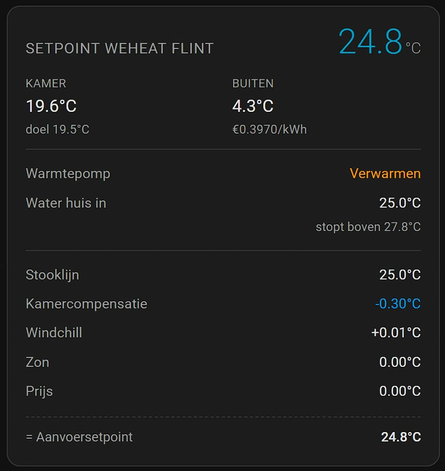

# WeHeat OpenTherm Card

Compacte Lovelace-kaart voor de [weheat_opentherm](https://github.com/FutureCow/ha-setpoint-heating) custom integratie.

Dit is een hobbyproject en geen product van WeHeat. "WeHeat OpenTherm" is de naam van de integratie waar de kaart bij hoort.

Toont in één oogopslag:

- Berekend **aanvoersetpoint** (groot, prominent)
- **Kamer-** en **buitentemperatuur** met gewenste waarde
- **Huidige energieprijs** (indien geconfigureerd)
- **Status van de warmtepomp** en de **watertemperatuur** met start-/stopgrens (optioneel)
- **Opbouw van de berekening**: stooklijn + alle correcties, kleur-gecodeerd
- **Uit** als de verwarming uit staat (handmatig of door de stookgrens)
- Een **waarschuwing** als een temperatuursensor is weggevallen en de integratie op een terugval rekent
- **(begrensd)** als het setpoint op de minimale of maximale aanvoertemperatuur is afgekapt

## Screenshot



## Installatie

### Via HACS (aanbevolen)

1. HACS → Frontend → 3-puntsmenu → "Custom repositories"
2. URL: `https://github.com/FutureCow/ha-weheat-opentherm-card`, categorie: `Lovelace`
3. "WeHeat OpenTherm Card" installeren
4. Browser refreshen (`Ctrl+F5`)

### Handmatig

1. `weheat-opentherm-card.js` downloaden naar `<config>/www/`
2. In HA: Instellingen → Dashboards → ⋮ → Resources → Toevoegen:
   - URL: `/local/weheat-opentherm-card.js`
   - Type: JavaScript Module

## Configuratie

```yaml
type: custom:weheat-opentherm-card
entity_prefix: sensor.weheat_opentherm
target_temp_entity: climate.weheat_opentherm_verwarmingsdoelwit
title: Verwarming
show_breakdown: true
show_price: true
# Optioneel: status en watertemperatuur van de warmtepomp
pump_status_entity: sensor.<warmtepomp>_heat_pump
pump_water_entity: sensor.<warmtepomp>_heat_pump_watertemperatuur_huis_in
pump_hysteresis: 3
```

### Opties

| Optie | Type | Default | Beschrijving |
|---|---|---|---|
| `entity_prefix` | string | **vereist** | Prefix van de integratie-entiteiten (meestal `sensor.weheat_opentherm`) |
| `target_temp_entity` | string | `null` | Climate-entiteit voor weergave van de doeltemperatuur |
| `title` | string | `"WeHeat"` | Tekst rechtsboven |
| `show_breakdown` | bool | `true` | Toon de formule-opbouw onder de samenvatting |
| `show_price` | bool | `true` | Toon de huidige energieprijs (alleen als beschikbaar) |
| `pump_status_entity` | string | `null` | Status-sensor van de warmtepomp (WeHeat-integratie); toont o.a. Verwarmen / Standby |
| `pump_water_entity` | string | `null` | Watertemperatuur "huis in" van de warmtepomp |
| `pump_hysteresis` | number | `3` | Hysterese van de warmtepomp in °C, voor de start-/stopgrens |

#### Warmtepomp-blok

Stel je `pump_status_entity` en/of `pump_water_entity` in, dan verschijnt een extra blok. De warmtepomp start pas als het water onder *setpoint − hysterese* zakt en stopt boven *setpoint + hysterese*. De kaart toont daarom bij stilstand "start onder …" en tijdens verwarmen "stopt boven …", zodat je ziet waarom de pomp wel of niet draait. Zonder deze opties blijft de kaart ongewijzigd.

De kaart leest automatisch de volgende suffixen onder `entity_prefix`:

- `_aanvoersetpoint` — eindwaarde, met de attributen `terugval` en `begrensd`
- `_buitentemperatuur`, `_kamertemperatuur` — inputs
- `_stooklijn_basistemperatuur` — basis stooklijn
- `_kamercompensatie`, `_windchill_correctie`, `_zoncorrectie`, `_prijscorrectie` — correctietermen
- `_huidige_energieprijs` — actuele prijs
- `_actieve_modus` — `heat` of `off`

Ontbrekende sensoren worden stilletjes overgeslagen.

**Engelstalige Home Assistant:** de integratie maakt de entity-ID's aan in de taal die HA had bij het toevoegen. De kaart herkent ook de Engelse namen (`_supply_setpoint`, `_outdoor_temperature`, `_active_mode` enzovoort); je hoeft daar niets voor in te stellen. Gebruik dan wel de Engelse climate-entiteit bij `target_temp_entity`: `climate.weheat_opentherm_heating_target`. De teksten op de kaart zelf zijn Nederlands.

## Vereisten

- Home Assistant 2024.11 of nieuwer
- De [weheat_opentherm](https://github.com/FutureCow/ha-setpoint-heating) integratie. De waarschuwing bij sensoruitval werkt vanaf v2.5.0; met oudere versies blijft de rest van de kaart gewoon werken

## Licentie

MIT
